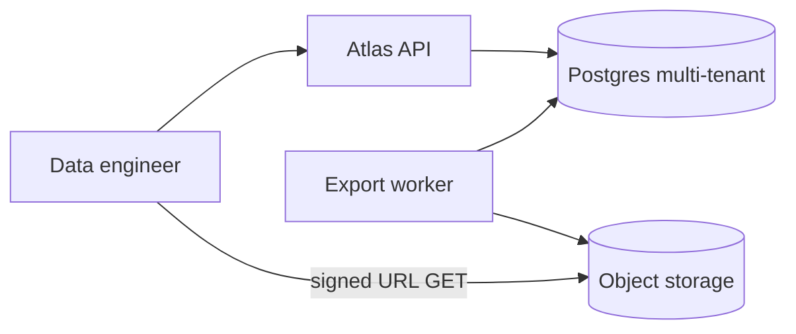
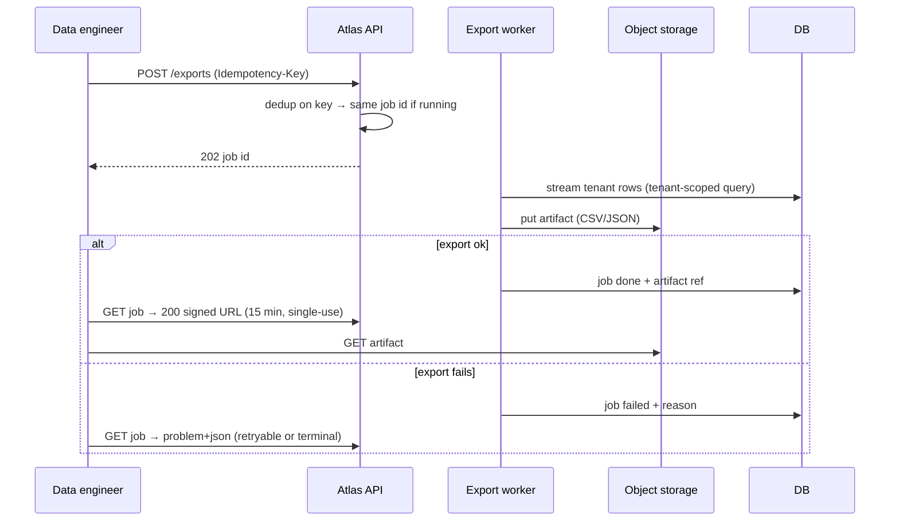

# RFC 0001: tenant-export

Status: accepted
Date: 2026-11-20
Author: Dev Patel (platform lead)
Reviewers: Maya Chen (CTO)
PRD: `docs/prd/tenant-export.md @ c7cd90e`
Approved by: Maya Chen (CTO), 2026-11-20

Stage skips, declared: **ux** — no user-facing surface (API-only persona, PRD §3). **erd** — no schema change: job state uses the existing `background_jobs` infrastructure table; artifacts land in object storage.

## 1. Context

Enterprise deals stall on data-portability clauses (PRD §2). Atlas is a multi-tenant logistics API; the export must read one tenant's data without ever exposing cross-tenant rows, and without degrading shared API capacity (guardrail p95 ≤200ms).

## 2. Goals

- Async export jobs: CSV/JSON artifact, tenant-scoped, rate-limited.
- Non-export API traffic unaffected (guardrail).
- Documented in the public OpenAPI — the clause says "documented export capability".

## 3. Non-goals

- UI, recurring schedules, other formats (PRD §8); backfill of historical soft-deletes (pending open question).

## 4. Alternatives considered

| Criterion (weight) | A: synchronous streaming response | B: async job + object storage signed URL | Do nothing |
|---|---|---|---|
| solves PRD problem (5) | 3 — times out on large tenants | 5 | 1 — deals keep stalling |
| capacity risk (4) | 1 — holds a connection per export | 5 — worker pool, no request held | 5 |
| security surface (3) | 3 — long-lived auth during export | 4 — short-lived single-use URL | 5 |
| operational complexity (2) | 5 — none new | 3 — artifact lifecycle (retention) | 5 |
| **Weighted total** | 36 | 60 | 38 |

## 5. Proposed design

Option B — POST creates a job row in the existing `background_jobs` table (kind=tenant_export, idempotency on the client's Idempotency-Key); a worker streams tenant rows to a CSV/JSON artifact in object storage; completion stores a 15-minute single-use signed URL. No significant choice beyond option B itself → no ADR spawned.

### C4 context

### Critical sequences

US-1 + US-2 (error branch included):

### Principles deviations

| Principle | Deviation | ADR |
|---|---|---|
| none — exports respect the repo resilience table: worker timeout bounded, job retry idempotent by job id, retention is a lifecycle policy | — | — |

## 6. Data

No schema change — existing `background_jobs` (kind + payload columns) and object storage artifacts with a 7-day retention policy.

## 7. API surface

Two endpoints, tenant-scoped tokens only: POST /v1/tenants/{tenantId}/exports, GET /v1/tenants/{tenantId}/exports/{jobId} — detail in `docs/api/atlas-openapi.yaml`.

## 8. Security considerations

Cross-tenant exposure is THE risk: job GET must be IDOR-proof; signed URLs short-lived and single-use; exports audited. Full STRIDE in `docs/security/tenant-export-threat-model.md`.

## 9. Observability

- `export_jobs_active` per tenant (cap alert at 5); export duration histogram; `export_authz_denied` counter (spikes → investigation).

## 10. Rollout

| Phase | Change | Rollback |
|---|---|---|
| 1 | code + rate limits behind `tenant_export` flag (off) | flag off |
| 2 | enable for the 3 negotiation tenants (with their teams watching) | flag off |
| 3 | GA after first successful enterprise export signed off | flag off |

## 11. Open questions

- 🔵 Soft-deletes in scope? Resolved 2026-11-20: excluded from v1; compliance ask would be a new feature (Maya Chen).
