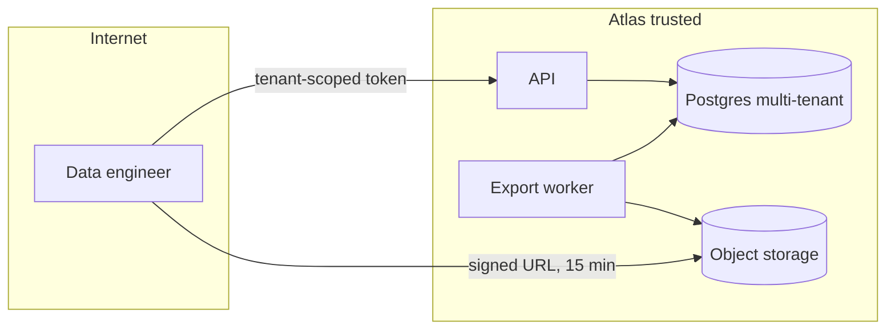

# Threat Model: tenant-export

Status: approved
Date: 2026-11-22
RFC: `docs/rfc/0001-tenant-export.md @ 7ed2900`
API spec: `docs/api/atlas-openapi.yaml @ 6e5dfdb`
Approved by: Lena Fischer (security), 2026-11-22

## 1. Elements, flows, trust boundaries

Boundaries crossed: E→API (tenant token, TLS); worker→DB (internal); worker→S3 (internal); E→S3 via pre-signed URL (short-lived, single-use).

## 2. STRIDE analysis

| ID | Element | Category | Threat | Sev | Lik | Score | Class |
|---|---|---|---|---|---|---|---|
| T1 | Export job GET | Elevation / IDOR | tenant A polls tenant B's job | 5 | 3 | 15 | prevent |
| T2 | Signed URL | Info disclosure | URL leaked/shared, replayed | 4 | 3 | 12 | prevent |
| T3 | Export worker | DoS | expensive export saturates shared capacity | 4 | 3 | 12 | mitigate |
| T4 | Export artifact | Tampering | CSV cells beginning =,+,-,@ execute as formulas on open (CSV injection) | 3 | 4 | 12 | prevent |
| T5 | Export audit | Repudiation | tenant claims export never ran / wrong data | 2 | 3 | 6 | detect |
| T6 | Stolen tenant token | Spoofing | full-tenant exfiltration via export | 5 | 2 | 10 | mitigate |

## 3. Mitigations

| Threat | Control | Type | Enforced where |
|---|---|---|---|
| T1 | jobId lookup joined against the token's tenantId; cross-tenant GET → 404 (no existence oracle) | prevent | API impl + OpenAPI scope note |
| T2 | 15-minute single-use URL; second GET → 403; artifact deleted after 7 days | prevent | worker + storage lifecycle |
| T3 | 5 concurrent jobs per tenant cap; row cap per job; worker pool isolated from request path | mitigate | RFC §9 |
| T4 | cells starting =,+,-,@,tab prefixed with apostrophe in CSV; documented in the response header | prevent | CSV serializer |
| T5 | job id, row count, checksum, and duration logged per export | detect | worker audit log |
| T6 | export requests audited + `export_authz_denied` alert; anomaly review weekly | mitigate/detect | RFC §9 |

## 4. Findings (ranked)

Blockers (15-25) — must be fixed before merge:

| ID | Finding | Fix plan | Status |
|---|---|---|---|
| F1 | CSV injection (T4) — customer data includes attacker-controllable strings | prefix dangerous cells + document | fixed 2026-11-22 (serializer test pinned) |

## 5. Accepted risks

| ID | Risk | Accepted by | Revisit date |
|---|---|---|---|
| R1 | a stolen tenant token can export that tenant's own data (rate-limited, audited) — token hygiene is the tenant's control | Maya Chen (CTO) | 2027-05-22 |

## 6. OWASP checklist results

Run `references/owasp-checklist.md`: 24 pass / 0 violations / 1 N-A-justified (no UI).

## 7. Data classification

| Field | Class | Handling rule |
|---|---|---|
| tenant business records | confidential | export only via tenant-scoped token; artifact encrypted at rest, 7-day retention |
| signed URLs | credential (short-lived) | never logged; single-use |
| export audit log | internal | retained 90 days |

## 8. Residual risk statement

IDOR is prevented by construction (tenant-joined lookup), URLs die in 15 minutes, and the request path is isolated from export cost. What remains: a compromised tenant token exports that tenant — inherent to the product promise, bounded by caps and audit.
