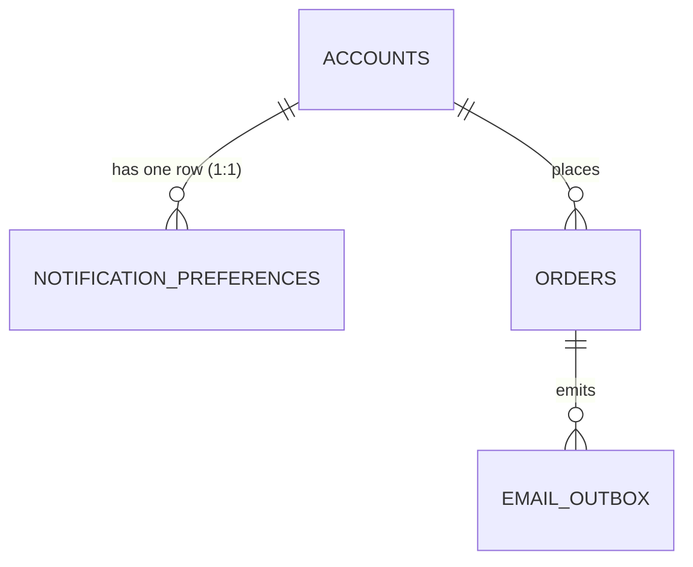

# ERD: order-emails

Status: approved
Date: 2026-11-19
RFC: `docs/rfc/0001-order-emails.md @ cecbd11`
Approved by: Sam Okafor (tech lead), 2026-11-19

## 1. Diagram

## 2. Table definitions

### `notification_preferences`

| Column | Type | Constraints | Notes |
|---|---|---|---|
| id | bigserial | PK | |
| account_id | bigint | FK → accounts ON DELETE CASCADE | one row per account |
| shipping_notices | boolean | NOT NULL DEFAULT true | confirmations are not optional (transactional necessity) |
| created_at | timestamptz | NOT NULL DEFAULT now() | |
| updated_at | timestamptz | NOT NULL DEFAULT now() | |

- Natural unique key(s): `uq_notification_preferences_account` (account_id) — also the idempotency guarantee for PUT.

### `email_outbox`

| Column | Type | Constraints | Notes |
|---|---|---|---|
| id | bigserial | PK | message id for provider dedup |
| order_id | bigint | FK → orders ON DELETE CASCADE | |
| kind | text | CHECK kind IN ('confirmation','shipping') | |
| payload | jsonb | NOT NULL | rendered at enqueue, immutable |
| status | text | CHECK status IN ('pending','sent','parked') | |
| attempts | int | NOT NULL DEFAULT 0 | |
| next_attempt_at | timestamptz | NOT NULL DEFAULT now() | worker claim key |
| sent_at | timestamptz | NULL | proof of send (threat model T3) |
| created_at | timestamptz | NOT NULL DEFAULT now() | |
| updated_at | timestamptz | NOT NULL DEFAULT now() | |

## 3. Indexes

| Index | Serves query | Leading column | Lock profile |
|---|---|---|---|
| email_outbox_status_next_idx | worker claim: status='pending' AND next_attempt_at <= now() | status | partial (WHERE status='pending'), CREATE CONCURRENTLY |
| uq_notification_preferences_account | prefs lookup + PUT idempotency | account_id | unique, CREATE CONCURRENTLY |

## 4. Denormalizations

| Field | Serves query | Refresh strategy |
|---|---|---|
| email_outbox.payload | worker never joins orders/products to render | written once at enqueue — immutable by design |

## 5. Migration plan

| Step | Statement | Locks writes? | Batches |
|---|---|---|---|
| expand | CREATE TABLE notification_preferences, email_outbox + both indexes CONCURRENTLY | no | n/a |
| backfill | INSERT prefs row (defaults) for each existing account | no | 1k rows / 100ms sleep |

**Rollback** (per step, written before running):

| Step | Rollback | Reversible |
|---|---|---|
| expand | DROP TABLE both (empty pre-flag) | yes |
| backfill | DELETE default prefs rows (idempotent) | yes |

**Contract step** (future release, owner): none — additive only; orders untouched.

## 6. Verification

- [ ] Ran on production-sized copy; duration measured (fixture: 250k accounts)
- [ ] Rollback rehearsed on staging copy
- [ ] Worker claim verified under 2 concurrent workers (SKIP LOCKED)
- [ ] States mirror the flow: sent/parked map 1:1 to the worker sequence in the RFC
