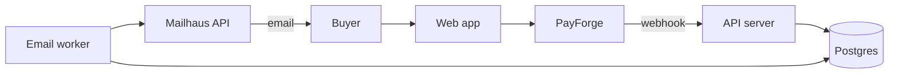
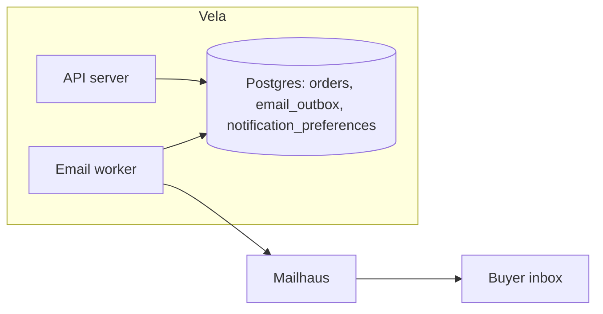

# RFC 0001: order-emails

Status: accepted
Date: 2026-11-18
Author: Sam Okafor (tech lead)
Reviewers: Alex Vega (PO), Nina Solís (design)
PRD: `docs/prd/order-emails.md @ 78a3574`
UX spec: `docs/ux/order-emails.md @ 0026fcb`
Approved by: Sam Okafor (tech lead), 2026-11-18

## 1. Context

Buyers get no timely proof of purchase (PRD §2). Checkout currently ends at the PayForge webhook; there is no email path. Mailhaus is contracted (99% SLA). We must send two transactional emails from existing order/payment events without slowing checkout — the guardrail (completion ≥60%) is a hard constraint.

## 2. Goals

- Confirmation email on payment success; shipping email on fulfillment.
- Delivery attempt <60s from event; 99% delivered <5 min.
- Checkout latency and reliability unaffected.

## 3. Non-goals

- SMS, in-app status page, marketing emails (PRD §8).
- A templating system beyond two handcrafted email templates.

## 4. Alternatives considered

| Criterion (weight) | A: send synchronously in the checkout request | B: outbox table + background worker | Do nothing |
|---|---|---|---|
| solves PRD problem (5) | 4 — sends, but couples money path to vendor | 5 — full solution | 1 — tickets keep growing |
| checkout latency risk (4) | 2 — adds 3rd-party call to the money path | 5 — fire-and-forget local insert | 5 |
| delivery reliability (3) | 2 — provider hiccup fails the send forever | 4 — bounded retry + park + alert | 1 |
| operational complexity (2) | 5 — none | 3 — new worker to run + monitor | 5 |
| **Weighted total** | 44 | 63 | 38 |

Choice B → significant choice recorded in `decisions/2026-11-18-order-emails-via-outbox.md` (ADR-0001).

## 5. Proposed design

An `email_outbox` table written in the same transaction as the order/payment event; a background worker drains it calling Mailhaus with a 10s timeout and bounded idempotent retry (max 3, exponential backoff), parking failures for human replay. Per-account `notification_preferences` gate every send.

### C4 context



### C4 container



### Critical sequences

US-1 confirmation (error branch included):

```mermaid
sequenceDiagram
    participant P as PayForge
    participant A as API
    participant W as Worker
    participant M as Mailhaus
    P->>A: payment.ok webhook (signed)
    A->>A: verify signature, mark order paid
    A->>A: insert email_outbox (kind=confirmation)
    Note over A: checkout request already returned - zero latency added
    loop every 10s
        W->>W: claim due rows (SKIP LOCKED)
        W->>M: send email (timeout 10s)
        alt provider ok
            W->>W: mark sent, record sent_at + message id
        else provider error
            W->>W: attempts++ ; next_attempt_at = now + backoff ; max 3 then park
        end
    end
```

### Principles deviations

Against the repo's `docs/principles.md` — every row links an ADR; "none" is a valid entry:

| Principle | Deviation | ADR |
|---|---|---|
| none — the design uses the repo's standard resilience table (timeout 10s, retry ×3 idempotent, park + alert) | — | — |

## 6. Data

New tables `email_outbox` and `notification_preferences` (detail in the ERD: `docs/data-model/order-emails-erd.md`); orders untouched.

## 7. API surface

One endpoint pair for preferences: GET/PUT /me/notification-preferences (detail in `docs/api/orders-openapi.yaml`); no public API for sending — internal events only.

## 8. Security considerations

Email domain spoofing (SPF/DKIM/DMARC), PII in emails, preferences authz (user-scoped), Mailhaus credential handling. Full STRIDE in `docs/security/order-emails-threat-model.md`.

## 9. Observability

- `outbox_parked_total` (>0 for 10 min → page); `outbox_backlog` gauge.
- Delivery latency histogram (event → sent), SLO 99% <5 min.

## 10. Rollout

| Phase | Change | Rollback |
|---|---|---|
| 1 | migrations + code behind `order_emails` flag (off) | flag off; additive tables harmless |
| 2 | worker on in staging, 48h soak | stop worker |
| 3 | flag 10% → 50% → 100% by delivery SLO | flag off (instant, tested in staging) |

## 11. Open questions

- 🔵 Reply-to resolved: support inbox (Alex Vega, 2026-11-17).

---

## Reviewer checklist

`references/design-review.md` run: 3 real alternatives scored; non-goals explicit; C4 context + container present; critical sequence includes the error branch; rollout reversible per phase; security section present. Status → accepted.
