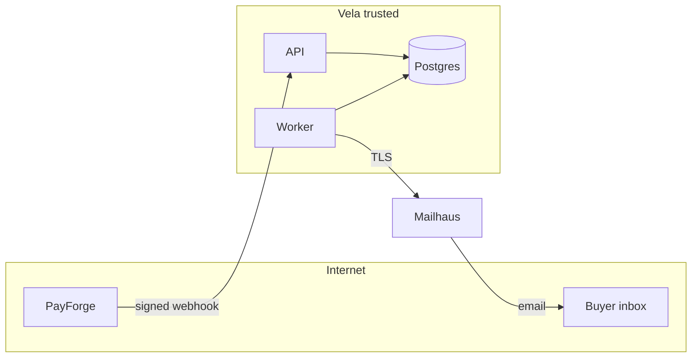

# Threat Model: order-emails

Status: approved
Date: 2026-11-20
RFC: `docs/rfc/0001-order-emails.md @ cecbd11`
API spec: `docs/api/orders-openapi.yaml @ c903c6a`
Approved by: Priya Nair (security), 2026-11-20

## 1. Elements, flows, trust boundaries

Boundaries crossed: PayForge→API (inbound, signature-verified); API→Postgres (internal); Worker→Mailhaus (outbound TLS, API key); Mailhaus→buyer inbox (email, minimized PII).

## 2. STRIDE analysis

| ID | Element | Category | Threat | Sev | Lik | Score | Class |
|---|---|---|---|---|---|---|---|
| T1 | Email domain | Spoofing | attacker spoofs @vela.store confirmations to phish buyers | 5 | 3 | 15 | prevent |
| T2 | email_outbox | Tampering | payload edited between enqueue and send → malicious content | 4 | 2 | 8 | prevent |
| T3 | Outbox log | Repudiation | buyer claims never notified; no proof of send | 3 | 4 | 12 | detect |
| T4 | Email content | Info disclosure | PII exposed to a forwarded inbox | 3 | 4 | 12 | mitigate |
| T5 | Preferences endpoint | Elevation | user A PUTs user B's prefs (IDOR) | 5 | 3 | 15 | prevent |
| T6 | Worker | DoS | retry storm against Mailhaus while degraded | 3 | 3 | 9 | mitigate |

## 3. Mitigations

| Threat | Control | Type | Enforced where |
|---|---|---|---|
| T1 | SPF + DKIM signing + DMARC p=quarantine on the sending domain | prevent | DNS / provider |
| T2 | payload immutable post-insert (no update path except status/attempts); worker runs a table-scoped DB role | prevent | ERD grants |
| T3 | sent_at + provider message id retained per outbox row | detect | ERD |
| T4 | emails carry order number + first name only; full details behind the authenticated order link | mitigate | email templates |
| T5 | endpoint is /me-scoped (no account id parameter); authz = session subject only | prevent | OpenAPI spec |
| T6 | attempts capped at 3 with exponential backoff; parked rows alert, never auto-retry | mitigate | ADR 0001 |

## 4. Findings (ranked)

Blockers (score 15-25) — must be fixed before merge:

| ID | Finding | Fix plan | Status |
|---|---|---|---|
| F1 | DMARC record absent on vela.store | add p=quarantine + monitoring before flag-on | fixed 2026-11-20 |

## 5. Accepted risks

| ID | Risk | Accepted by | Revisit date |
|---|---|---|---|
| R1 | PII in the receipt email is inherent to the product; minimized, not eliminated | Dana Ríos (CEO) | 2027-02-20 |

## 6. OWASP checklist results

Run `references/owasp-checklist.md`: 21 pass / 0 violations / 2 N-A-justified (no admin surface; no file upload).

## 7. Data classification

| Field | Class | Handling rule |
|---|---|---|
| email address | PII | never in query strings or logs; outbox logs carry row id only |
| order payload (items, total) | internal | encrypted at rest; emails minimized (T4) |
| Mailhaus API key | credential | worker env secret, rotated quarterly |

## 8. Residual risk statement

With DMARC live, IDOR impossible by construction (/me scope), and retries bounded, the remaining exposure is a compromised Mailhaus account reading sent email — covered under their SOC2 attestation, revisited 2027-02-20.
