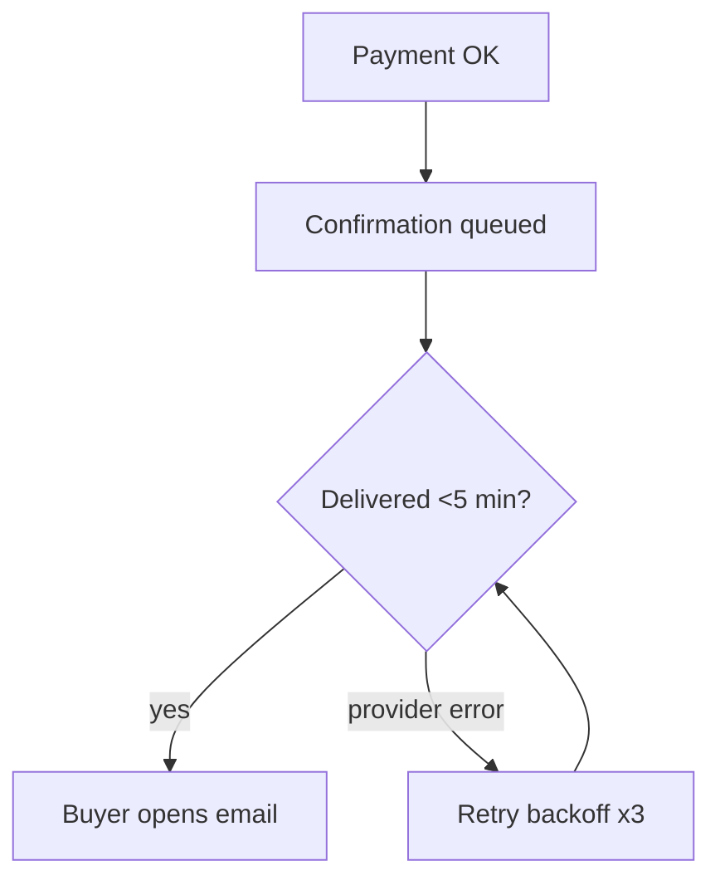
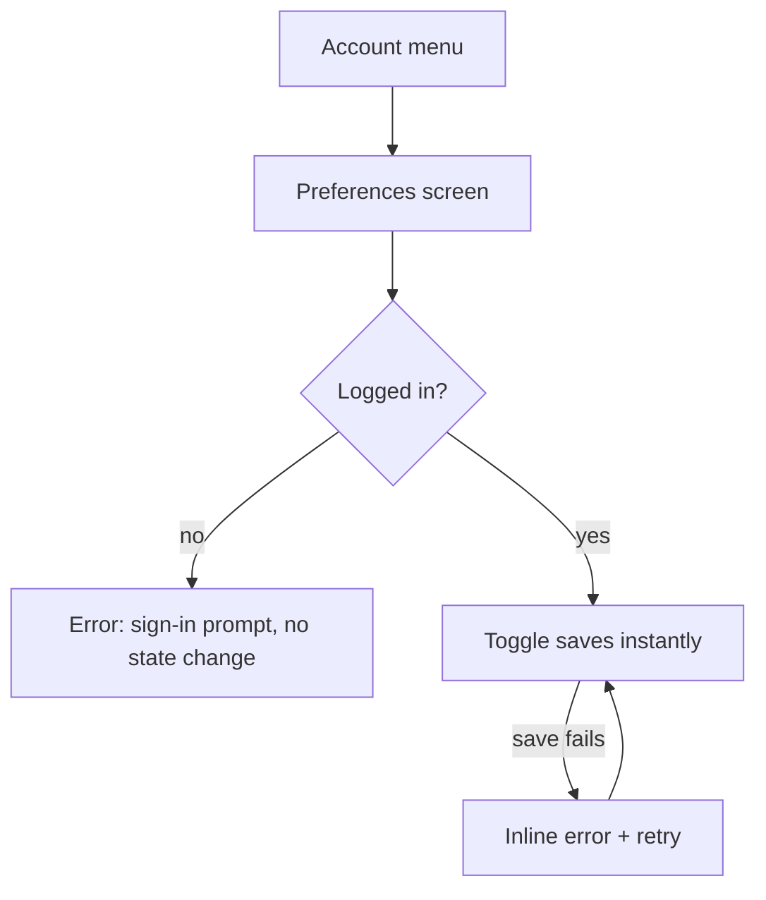

# UX Spec: order-emails

Status: approved
Date: 2026-11-16
PRD: `docs/prd/order-emails.md @ 78a3574`
Approved by: Nina Solís (design lead), 2026-11-16
Fidelity: low (text-first emails + one existing-pattern screen)

## 1. User flows

US-1: receive confirmation

US-2: notification preferences

US-3: shipping notice — backend-only flow (no user-facing screen); the preferences gate applies.

## 2. Screen inventory

| # | Screen | Flows served | Entry points | States covered |
|---|---|---|---|---|
| 1 | Notification preferences | US-2 | account menu, email footer link | empty/loading/error/success |
| 2 | Email: order confirmation | US-1 | email client | content spec §3.2 |
| 3 | Email: shipping notice | US-3 | email client | content spec §3.3 |

## 3. Screen specs

### Screen 1: Notification preferences

- **Purpose:** control transactional email per account.
- **Layout regions:** single card inside the existing settings layout; no new navigation.
- **States:**
  - Empty: n/a — always reflects current prefs.
  - Loading: existing settings skeleton; toggles disabled.
  - Error: recoverable — inline "Couldn't save. Retry." with a retry action; fatal — existing settings escape (support link).
  - Success: silent save; the toggle state is the confirmation.
- **Components used:** existing card; 🆕 labeled-toggle (label + description + switch).
- **Copy:**
  - Title: "Email notifications"
  - Toggle 1: "Order confirmations" — "Proof of purchase for every order." (default ON, locked — transactional necessity 🔵 pending legal confirm)
  - Toggle 2: "Shipping notices" — "When each order ships, with tracking." (default ON)
  - Error: "Couldn't save your preference. Try again." + button "Retry"
- **Accessibility notes:** focus order title → toggle 1 → toggle 2; each switch is a labelled control (aria-describedby = description); save errors announced via aria-live="polite".

### Screen 2: Email — order confirmation (content spec)

- Subject: "Order confirmed — #<order-number>"
- Regions: header (logo), order summary (items, qty, price, total), support link, footer (preferences link).
- Copy rules: total prominent; link text describes destination ("View order status"); plain-text fallback provided.

### Screen 3: Email — shipping notice (content spec)

- Subject: "Your order has shipped — #<order-number>"
- Regions: tracking link (descriptive text, never a bare URL), items shipped, preferences link.

## 4. Design token deltas

| Token | Value | Used for |
|---|---|---|
| none — emails use the provider template; the screen reuses existing tokens | | |

## 5. New components

| Component | Variants | States | Props sketch | Screens |
|---|---|---|---|---|
| labeled-toggle | default, locked | on/off/disabled/error | {label, description, value, locked, onChange} | Screen 1 |

## 6. Accessibility pass (spec-time only)

- [x] Spec-time checklist from `../references/accessibility.md` verified on this document: focus order specified, labels + aria-describedby + aria-live written into state specs, descriptive link text, titles per screen, target sizes inherit existing tokens.
- [x] Implementation-time items (axe, keyboard-only, screen-reader, measured contrast) queued into the `qa` test plan as the accessibility test procedure — NOT claimed here.

## 7. Open questions

- 🔵 Is "Order confirmations" legally lockable (transactional necessity)? — owner: Alex Vega — before RFC.
