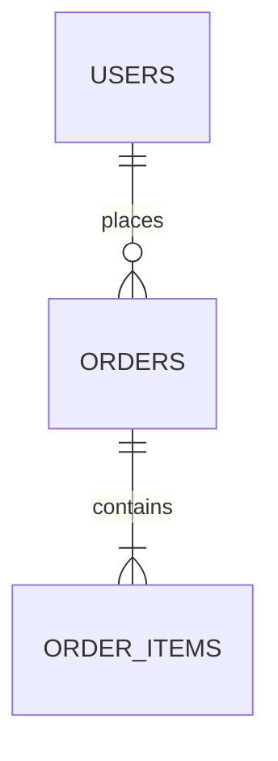

# ERD: <feature-slug>

Status: draft | approved
RFC: `docs/rfc/NNNN-<slug>.md @ <approval sha>`
Date: YYYY-MM-DD
Approved by: <name> (<role>), <date>

## 1. Diagram

Every relationship line carries explicit cardinality (1:1, 1:N, M:N via join table).

## 2. Table definitions

### `<table>`

| Column | Type | Constraints | Notes |
|---|---|---|---|
| id | bigserial | PK | |
| | | FK → <table> ON DELETE <behavior> | |

- Natural unique key(s):
- CHECK constraints / allowed values:
- `created_at timestamptz`, `updated_at timestamptz` (mandatory)

## 3. Indexes

| Index | Serves query | Leading column | Lock profile |
|---|---|---|---|
| `<table>_<col>_idx` | "list X filtered by Y" | | concurrent? |

## 4. Denormalizations

| Field | Serves query | Refresh strategy |
|---|---|---|
| (only with written justification) | | trigger/view/job |

## 5. Migration plan

| Step | Statement | Locks writes? | Batches |
|---|---|---|---|
| expand | | no | n/a |
| backfill | | no | 1k rows / 100ms sleep |

**Rollback** (per step, written before running):

| Step | Rollback | Reversible |
|---|---|---|
| | | yes / no→human sign-off |

**Contract step** (future release, owner): drop `<what>`, scheduled for `<release>`.

## 6. Verification

- [ ] Ran on production-sized copy; duration measured
- [ ] Rollback rehearsed or snapshot path verified
- [ ] Replica-lag alarm threshold set during backfill
- [ ] States mirror the UX spec state machine 1:1
