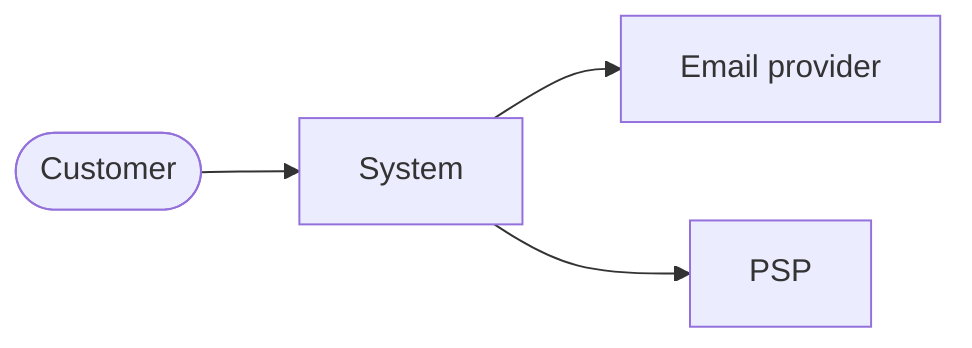
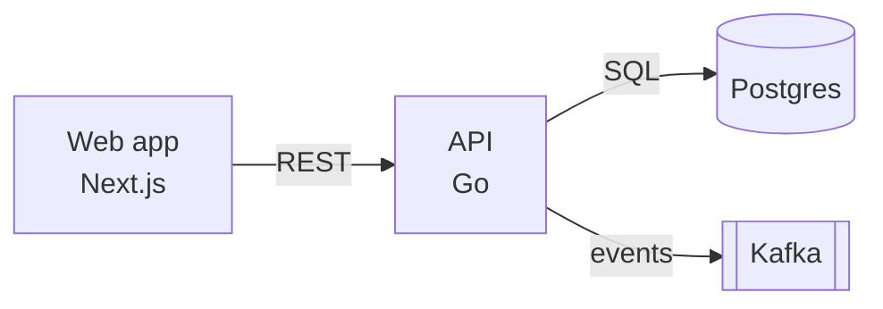

# C4, tradeoffs, review checklist

## C4 in mermaid

**Context** — who and what talks to the system:

**Container** — deployable units and their protocols (include data stores):

**Sequence** — one per critical flow (uses the PRD story name); show error branches, not just the happy path.

Skip component and code levels in RFCs — they rot before the ink dries.

## Tradeoff table

| Criterion (weight) | Option A | Option B | Do nothing |
|---|---|---|---|
| Latency budget (×3) | | | |
| Operational cost (×2) | | | |
| Team familiarity (×2) | | | |
| Reversibility (×1) | | | |
| **Weighted total** | | | |

Rules: criteria come from the PRD's constraints; score 1–5 with one sentence of justification each — a number without a sentence is a guess; the "do nothing" column must be genuinely evaluated (sometimes it wins).

## Review checklist (reviewer runs this)

- [ ] Problem restated correctly; a stranger to the meetings understands it
- [ ] Non-goals explicit
- [ ] ≥2 real alternatives + do nothing, scored with justification
- [ ] Chosen approach justified; significant choices have an ADR link
- [ ] C4 context + container present and match the described flows
- [ ] Every PRD acceptance criterion is either covered by a design element or explicitly deferred with a reason
- [ ] Failure modes addressed: what happens when the new component is down/slow/wrong?
- [ ] Rollout phased with rollback per phase; coexistence with the old path stated
- [ ] Security considerations section present (feeds `security` later, doesn't replace it)
- [ ] Observability: new metrics/logs/traces named
- [ ] No hidden rewrites disguised as features

## Anti-patterns

- The 20-page RFC for a CRUD feature — depth follows scope, per the decision gates.
- Alternatives theater: two strawmen next to the pre-chosen answer.
- "Phase 2 will handle it" with no phase-2 owner — deferred work must have a name attached.
- Diagrams without failure branches — reviewers infer you didn't think about them.
