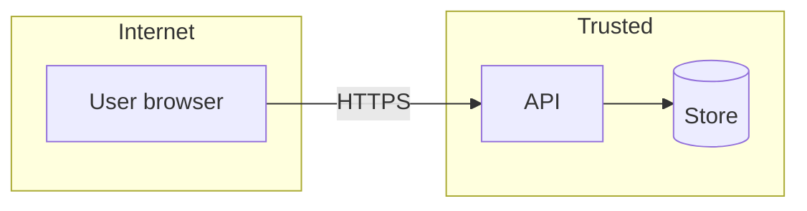

# Threat Model: <feature-slug>

Status: draft | approved
RFC: `docs/rfc/NNNN-<slug>.md @ <approval sha>`
API spec: `docs/api/<service>-openapi.yaml @ <approval sha>` (if any)
Date: YYYY-MM-DD
Approved by: <name> (<role>), <date>

## 1. Elements, flows, trust boundaries

Boundaries crossed: list each crossing with data, direction, auth, encryption.

## 2. STRIDE analysis

| ID | Element | Category | Threat | Sev (1-5) | Lik (1-5) | Score | Class |
|---|---|---|---|---|---|---|---|
| T1 | API | Spoofing | stolen JWT replay | | | | |

(N/A categories justified one line each.)

## 3. Mitigations

| Threat | Control | Type (prevent/detect/respond) | Enforced where |
|---|---|---|---|
| T1 | short-lived JWT + rotation | prevent | API gateway |

## 4. Findings (ranked)

Blockers (15-25) — must be fixed before merge:

| ID | Finding | Fix plan | Status |
|---|---|---|---|

## 5. Accepted risks

| ID | Risk | Accepted by | Revisit date |
|---|---|---|---|

## 6. OWASP checklist results

Run `references/owasp-checklist.md`; list violations as findings above. Summary: X pass / Y violations / Z N-A-justified.

## 7. Data classification

| Field | Class (PII/financial/credential/internal) | Handling rule |
|---|---|---|

## 8. Residual risk statement

After mitigations, what remains — one paragraph, no hand-waving.
