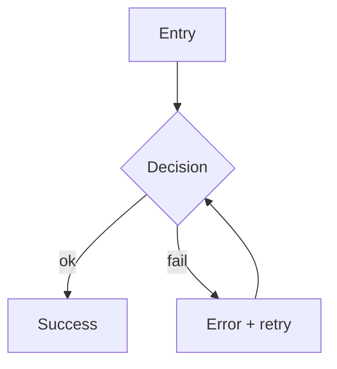

# UX Spec: <feature-slug>

Status: draft | approved
Date: YYYY-MM-DD
PRD: `docs/prd/<feature-slug>.md @ <approval sha>`
Approved by: <name> (<role>), <date>
Fidelity: low | mid | high | prototype

## 1. User flows

One mermaid flowchart per PRD story, named `US-<n>: <story>`; happy path + failure branches; error recovery returns to last valid step.

## 2. Screen inventory

| # | Screen | Flows served | Entry points | States covered |
|---|---|---|---|---|
| 1 | | US-2, US-3 | nav, redirect | empty/loading/error/success |

## 3. Screen specs

### Screen 1: <name>

- **Purpose:**
- **Layout regions:** (header / main / sidebar / modal…)
- **States:**
  - Empty: first-use copy + CTA / no-data copy / filtered-to-empty copy
  - Loading: skeleton (content) + what stays interactive
  - Error: recoverable → retry action; fatal → escape + support
  - Success: confirmation + what unlocks next
- **Components used:** (from inventory; new components flagged 🆕)
- **Copy:** real labels, buttons, empty/error messages (placeholders marked)
- **Accessibility notes:** focus order, labels, live regions, contrast checks

## 4. Design token deltas

| Token | Value | Used for |
|---|---|---|

## 5. New components

| Component | Variants | States | Props sketch | Screens |
|---|---|---|---|---|

## 6. Accessibility pass (spec-time only)

- [ ] Spec-time checklist from `../references/accessibility.md` verified on this document: focus order, labels, error copy, titles/landmarks, target sizes in tokens, motion spec
- [ ] Implementation-time items (axe, keyboard-only, screen-reader, measured contrast) queued into the `qa` test plan as the accessibility test procedure — NOT claimed here

## 7. Open questions

- 🔵 …
